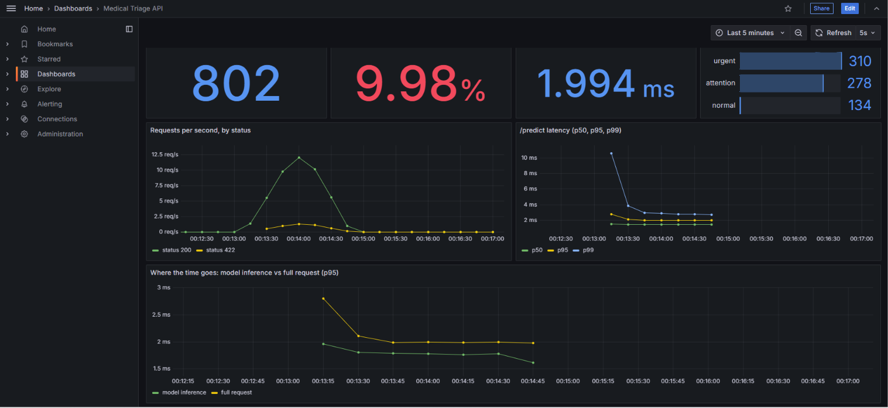
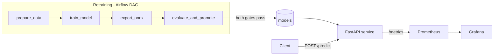
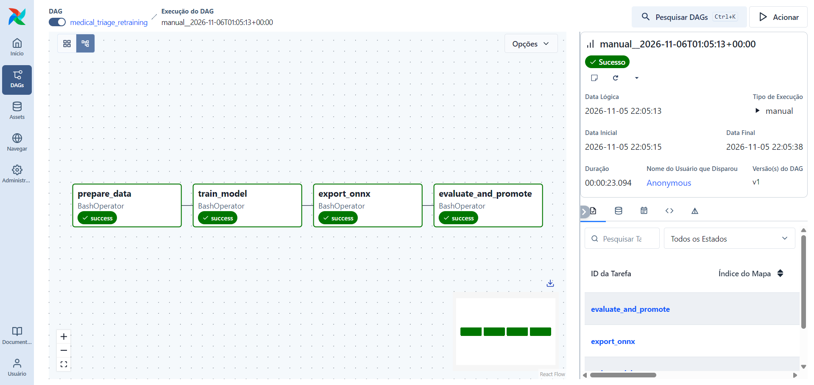

# Medical Triage MLOps


Automatic urgency triage for medical text, served by a REST API and wrapped in a full MLOps lifecycle: CI, orchestrated retraining with quality gates, monitoring, and latency optimization.

> **Disclaimer:** educational and portfolio project. It is not a medical device and must not support clinical decisions. The urgency levels are a *proxy* derived from the medical area of the text, with no clinical validation (see [Limitations](#limitations-and-next-steps)).

Built from the Phase 3 Tech Challenge (Cloud & MLOps) of the Machine Learning Engineering postgraduate program at FIAP.

## Results at a glance

| | |
|---|---|
| **Model** | TF-IDF + Random Forest · macro F1 **0.76** over 5 medical areas · **0.85 recall** on the "urgent" class (held-out test set) |
| **API latency** | p50 from **28.3 ms to 2.3 ms** (~12x faster) by fixing a parallelism setting and moving the forest to ONNX Runtime |
| **Pipeline** | GitHub Actions CI (lint + 14 tests) · Airflow retraining DAG with two promotion gates · Prometheus + Grafana (7 panels) · everything in Docker |



## Problem and approach

Health services receive large volumes of clinical text and need to prioritize the most severe cases. This project implements the service that would do that prioritization: it receives a medical text and returns the **medical area**, the **urgency level** (`urgent`, `attention` or `normal`) and the **confidence** of the prediction.

```bash
curl -X POST http://127.0.0.1:8000/predict \
  -H "Content-Type: application/json" \
  -d '{"text": "Coronary artery bypass grafting in patients with acute myocardial infarction and left ventricular dysfunction."}'
# {"category":"cardiovascular_diseases","urgency":"urgent","confidence":0.915}
```

Two design decisions shape everything else:

1. **The model predicts the medical area (5 classes), and an editable table converts the area into urgency.** The business rule lives in `configs/urgency_mapping.json`, outside the model. If a clinician decides an area belongs to another level, one line changes and no retraining is needed.
2. **The system around the model is the product.** That is why the classifier is deliberately light (TF-IDF + Random Forest): the effort goes into CI/CD, orchestration, observability and latency.

| Area (dataset category) | Urgency |
|---|---|
| Cardiovascular diseases · Nervous system diseases | `urgent` |
| Neoplasms · Digestive system diseases | `attention` |
| General pathological conditions | `normal` |

The criterion was how fast a condition tends to deteriorate. `normal` is a naming convention: it means the topic alone does not indicate priority, not that the condition is trivial.

## Architecture



## Data

**Medical Abstracts TC Corpus** (Kaggle): 11,550 training abstracts and 2,888 test abstracts in 5 condition categories. Check the dataset page for its license. The files are not versioned in this repository.

**Finding during exploration** (`notebooks/01_data_exploration.ipynb`): the dataset contains abstracts that belong to several categories and were stored once per category, producing the same text with different labels:

- 1,956 repeated texts in train, **all** with conflicting labels (113 in test);
- 988 texts appear in both train and test, **all** with different labels on each side.

A text with two "correct" answers cannot be scored fairly. The cleaning step (`src/data_cleaning.py`, unit tested) removes every text with more than one distinct label **across train and test combined**, leaving **6,607 training texts and 1,691 test texts** (about 43% and 41% fewer). Cleaning each file separately would miss texts that appear once on each side with different labels.

## Model

TF-IDF (unigrams and bigrams, 20,000 terms) followed by a 200-tree Random Forest with `class_weight="balanced"`, because the classes are imbalanced (the smallest holds about 8% of the cleaned training texts).

| Experiment (20% validation split of the training set) | Macro F1 (5 areas) | Urgent recall |
|---|---|---|
| No `class_weight` | 0.704 | 0.758 |
| `class_weight="balanced"` | 0.752 | 0.851 |

Final evaluation, once, on the cleaned test set (1,691 texts): **macro F1 0.760 · urgent recall 0.850**. For reference, always predicting the largest category scores about 28%.

In triage the costly mistake is labeling an urgent case as not urgent, so the tracked metric is the recall of that class rather than accuracy.

## Latency optimization

| Configuration | p50 | p95 | p99 | Memory |
|---|---|---|---|---|
| Original (scikit-learn, `n_jobs=-1`) | 28.25 ms | 32.51 ms | 40.32 ms | 271 MiB |
| scikit-learn with `n_jobs=1` | 8.56 ms | 10.58 ms | 12.08 ms | 266 MiB |
| **ONNX Runtime** (TF-IDF in scikit-learn + forest in ONNX) | **2.30 ms** | **3.08 ms** | **3.72 ms** | 516 MiB |

**How I got there:**

1. **Measure first.** The API exposes a histogram of inference time only, and almost all server-side time was in the model, not in HTTP or serialization.
2. **Per-stage profile** (`scripts/profile_pipeline.py`, one prediction at a time, outside the API): TF-IDF 0.29 ms; forest with `n_jobs=-1` 25.2 ms; forest with `n_jobs=1` 6.5 ms; forest in ONNX 0.06 ms.
3. **The bottleneck was a parameter.** `n_jobs=-1` helps training, but for a single text, coordinating threads costs more than it saves. Setting it to `1` is already **3.3x** faster with no retraining.
4. **ONNX only for the forest.** TF-IDF stays in scikit-learn, because its tokenization converted to ONNX can diverge from the original. Parity was checked on all 1,691 test texts (`scripts/check_onnx_parity.py`): 4 predictions differ (0.24%), all of them **exact probability ties**, and the maximum confidence difference is zero.
5. **The trade-off is memory:** 516 MiB versus 266 MiB. The backend is therefore configurable (`MODEL_BACKEND`, `SKLEARN_N_JOBS`, `ONNX_THREADS`), and the same container runs any variant.

**Method:** 500 sequential requests (after warm-up) using test-set texts, over HTTP against the Docker container, on a Windows laptop with 20 logical threads, plugged in and in performance mode. These are **local numbers and do not transfer to other environments**. An accidental run on battery power raised p50 from ~28 to ~40 ms, which shows that the measurement environment matters as much as the code. Raw results are in `docs/latency_*.json`.

## MLOps pipeline

**CI (GitHub Actions)**: on every push to `main` and on pull requests, lint (`ruff`) and tests (`pytest`, 14 tests) run in a clean environment with the versions pinned in `poetry.lock`. The API is tested against both backends (scikit-learn and ONNX) using a tiny model built by the tests themselves, so they do not depend on the real artifacts.

**Retraining (Airflow)**: the `medical_triage_retraining` DAG (weekly, also runnable on demand) has four tasks: `prepare_data → train_model → export_onnx → evaluate_and_promote`. A full run takes about 23 seconds on my machine.



- Training runs in an isolated virtual environment inside the Airflow image, installed from the **same `poetry.lock` as the API**, so the model is trained and served with the same library versions.
- The new model is saved as a **candidate** and replaces the one in use only if it passes **two gates**: urgent recall on the test set **≥ 0.80** (`MIN_URGENT_RECALL`), and an ONNX export that reproduces the scikit-learn probabilities within **1e-4** (the last run measured 1.9e-7). If a gate fails, the task fails and the serving model is untouched. A worse retrain cannot be promoted unnoticed.

**Monitoring (Prometheus + Grafana)**: the API exposes `/metrics` with `http_requests_total`, `http_request_duration_seconds`, `model_inference_seconds` and `predictions_total` (by urgency level). Grafana starts provisioned, with the dashboard versioned under `monitoring/grafana/`, and has 7 panels: total requests, error rate, p95 latency, predictions by urgency, requests per second by status, p50/p95/p99 latency, and model inference vs full request.

## Cloud architecture decision

**Real time, not batch.** Prioritizing care requires an immediate answer for each text, so inference is an online service (request/response). Batch processing suits re-scoring a historical archive, which is where retraining fits: a scheduled job outside the request path.

**AWS with ECS Fargate.** The Docker image goes to ECR and runs on Fargate (containers without managing servers) behind an Application Load Balancer, with a health check on `/health`. The model is light (CPU only, no GPU) and needs predictable latency, and `/metrics` integrates with Prometheus/Grafana or with AWS monitoring services. Educational credit was available on the account.

**Alternatives considered:**

- *AWS Lambda (container)*: good for sporadic traffic, but cold starts reload the model, which conflicts with low, predictable latency.
- *EC2*: more control, at the cost of managing servers and updates.
- *SageMaker endpoint*: more features than a light CPU classifier needs.
- *Azure Container Apps / Google Cloud Run*: equivalent to Fargate, passed over because of the available AWS credit.

**Current state:** the stack was validated locally with Docker. The AWS deployment is **documented and not executed**.

## Running it

Prerequisites: Python 3.12, [Poetry](https://python-poetry.org/) and Docker.

```bash
git clone https://github.com/GFurts/medical-triage-mlops.git
cd medical-triage-mlops
poetry install
```

**1. Data.** Download the Medical Abstracts TC Corpus from Kaggle and place `medical_tc_train.csv`, `medical_tc_test.csv` and `medical_tc_labels.csv` in `data/raw/`.

**2. Train and export the model.**

```bash
poetry run python -m src.train
```

This runs the four pipeline steps (prepare, train, export to ONNX, evaluate and promote) and writes `models/model.joblib`, `models/vectorizer.joblib` and `models/forest.onnx`. These artifacts are not versioned, so generate them **before** building the Docker image.

**3. API locally.**

```bash
poetry run uvicorn src.api:app
# other backend: MODEL_BACKEND=sklearn SKLEARN_N_JOBS=1 poetry run uvicorn src.api:app
# (PowerShell: $env:MODEL_BACKEND="sklearn")
```

Interactive docs at `http://127.0.0.1:8000/docs`.

**4. API + Prometheus + Grafana.**

```bash
cp .env.example .env          # Windows: copy .env.example .env  (set the Grafana password)
docker compose up --build
poetry run python scripts/generate_traffic.py     # populates the dashboard
```

API on `:8000` · Prometheus on `:9090` · Grafana on `:3000` ("Medical Triage API" dashboard).

**5. Airflow (retraining).**

```bash
docker compose -f docker-compose.airflow.yml up --build
```

UI at `http://localhost:8080` (no login, local only). Enable and trigger the `medical_triage_retraining` DAG.

**6. Tests, lint and benchmark.**

```bash
poetry run pytest
poetry run ruff check .
poetry run python scripts/benchmark_latency.py --label my_test
```

### Configuration

| Variable | Default | Purpose |
|---|---|---|
| `MODEL_BACKEND` | `onnx` | `onnx` or `sklearn` |
| `SKLEARN_N_JOBS` | unset | threads for the scikit-learn forest (`1` is fastest for single requests) |
| `ONNX_THREADS` | unset | intra-op threads for ONNX Runtime |
| `MODELS_DIR` | `models` | where the serving artifacts are loaded from |
| `MIN_URGENT_RECALL` | `0.80` | recall gate used when promoting a retrained model |

## Repository structure

```
.github/workflows/ci.yml       CI: lint + tests
airflow/Dockerfile             Airflow image + isolated training environment
configs/urgency_mapping.json   business rule: medical area -> urgency
dags/retraining_dag.py         retraining DAG
docs/                          latency results (JSON) and images
models/metrics.json            metrics of the model in use (artifacts are not versioned)
monitoring/                    Prometheus and Grafana configuration (dashboard as code)
notebooks/                     data exploration
scripts/                       benchmark, profiling, ONNX parity check, traffic generator
src/                           API, data cleaning, training, ONNX export and backends
tests/                         API tests (both backends), cleaning, ONNX parity and quality gate
Dockerfile                     API image
docker-compose.yml             API + Prometheus + Grafana
docker-compose.airflow.yml     Airflow (standalone mode, for development)
```

## Limitations and next steps

**Limitations:**

- **The urgency label is a proxy.** It comes from a lookup over the medical area, with no clinical validation. The model recognizes the *topic* of a text, not the severity of a patient.
- **Data:** research abstracts, not patient reports.
- **Optimistic evaluation.** Ambiguous texts were removed from the test set, so the metrics hold for single-category texts, while real traffic would include ambiguous ones. There is a single train/test split and no cross-validation, and the smallest class has only ~140 test examples.
- **A recall of 0.85 means about 15% of urgent cases are labeled as not urgent.**
- **Ties:** in 4 of 1,691 texts ONNX and scikit-learn break ties differently. There is no conservative tie-break (toward the more urgent class) and no low-confidence warning.
- **Promotion is not atomic.** The three serving files are copied one after another, so a service restarting mid-copy could load a mix of old and new files.
- **Artifacts live outside Git.** Whoever clones the repo must train before building the image. A production setup would use a model registry or a versioned bucket.
- **Local latency only.** The AWS deployment is documented and not executed, and free-tier hosting CPUs are far smaller than the test machine's.
- **Development-grade settings:** Airflow in `standalone` mode (SQLite) and the default Grafana password are for local use.

**Next steps:** conservative tie-breaking and a minimum-confidence threshold; cross-validation; a model registry with versioning; deployment to AWS.